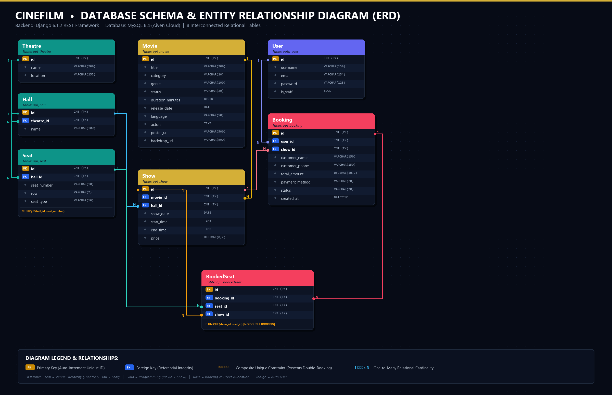
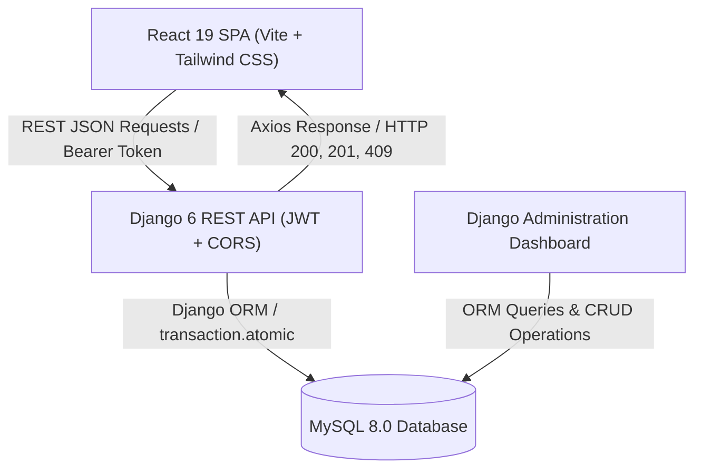

# Cinefilm

An automated, database-driven cinema management and ticket booking system engineered with Django REST Framework, React, and MySQL.


---

## Overview

**Cinefilm** is a full-stack cinema management platform that models real-world multiplex operations. It provides centralized scheduling across multiple theatre branches, interactive auditorium seat maps with tiered pricing (Regular vs. Premium), atomic reservation transactions preventing double-booking race conditions, and localized Mobile Financial Service (MFS) payment recording (bKash and Nagad).

---

## Visual Assets & Database ERD

The underlying database schema enforces referential integrity across 8 core relational entities:



---

## Features

- **Atomic Concurrency & Zero Double-Booking**: Wraps seat reservation in `transaction.atomic()` inside `CreateBookingView` and enforces a database composite unique constraint (`unique_show_seat_booking`) on `(show, seat)` to eliminate race conditions during simultaneous checkouts.
- **Dynamic 2D Seat Matrix Visualization**: Live endpoint (`GET /api/shows/<show_id>/seats/`) returns physical seats categorized by tier (`REGULAR` vs. `PREMIUM`) and dynamically flags occupied seats against existing bookings.
- **Multi-Branch Theatre & Auditorium Management**: Supports multiple physical multiplex branches (e.g., Bashundhara Shopping Mall, Sony Square, Finlay Square, Ball Arcade) and multi-hall layouts with isolated seat configurations.
- **Movie Catalog & Lifecycle Management**: Segregates films into `NOW_SHOWING` and `COMING_SOON` categories, accompanied by hero slideshow banners, cast/genre details, and format tags (IMAX, 3D, 2D).
- **JWT Authentication & Auto-Refresh**: Uses `djangorestframework-simplejwt` with 30-minute access token lifespan and automated Axios interceptor refresh on `401 Unauthorized` responses.
- **Localized Payment Options**: Supports regional mobile banking payment logging (`BKASH`, `NAGAD`) alongside customer identification data.
- **Staff Administration Portal**: Built-in Django Admin dashboard (`/admin/`) to manage movie schedules, hall capacities, price overrides, and booking audits.

---

## Tech Stack

| Layer | Technology | Version | Purpose |
| :--- | :--- | :--- | :--- |
| **Backend Framework** | Django | `6.1.2` | Core web framework, ORM, and admin portal |
| **API Framework** | Django REST Framework | `3.18.3` | RESTful endpoints and serializers |
| **Authentication** | djangorestframework-simplejwt | `5.5.1` | JSON Web Token (JWT) issuance and validation |
| **Database Engine** | MySQL (via `mysqlclient`) | `2.3.0` | Relational storage with InnoDB ACID transactions |
| **Environment Config** | python-dotenv | `1.2.4` | Loading environment variables from `.env` |
| **WSGI Server** | Gunicorn | *(Production)* | Production application server |
| **Frontend Framework** | React | `19.2.8` | Component-based single-page user interface |
| **Build Tool** | Vite | `8.3.0` | Frontend dev server and production bundler |
| **CSS Framework** | Tailwind CSS | `4.3.3` | Utility-first styling with `@tailwindcss/vite` |
| **Client Routing** | React Router DOM | `7.18.4` | Client-side routing (`createBrowserRouter`) |
| **HTTP Client** | Axios | `1.20.0` | Asynchronous API calls with request/response interceptors |
| **Icons** | Lucide React | `1.61.0` | Cinema and navigation SVG icons |

---

## Architecture

Cinefilm utilizes a decoupled three-tier client-server architecture:



1. **Presentation Layer**: React 19 Single Page Application communicating asynchronously via Axios.
2. **Business Logic Layer**: Django REST Framework API handling authentication, validation, schedule filtering, and transaction coordination.
3. **Data Layer**: MySQL database enforcing foreign key cascades, unique constraints (`unique_hall_seat`, `unique_show_seat_booking`), and row-level locking.

---

## Project Structure

```
Dbms-Project/
├── backend/
│   ├── api/
│   │   ├── management/commands/
│   │   │   └── seed_data.py       # Initial wireframe data population script
│   │   ├── migrations/            # Django database migrations
│   │   ├── admin.py               # Django Admin registration for all models
│   │   ├── models.py              # 8 Relational models (Theatre, Hall, Seat, Movie, Show, Booking, BookedSeat)
│   │   ├── serializers.py         # DRF serializers with nested relationships
│   │   ├── urls.py                # Domain API route declarations
│   │   └── views.py               # API views and atomic booking logic
│   ├── backend/
│   │   ├── settings.py            # Global Django configuration & JWT settings
│   │   ├── urls.py                # Root URL configuration
│   │   └── wsgi.py                # WSGI application entrypoint
│   ├── manage.py
│   └── .env                       # Backend database & secret configuration
├── frontend/
│   ├── public/
│   │   └── images/                # Poster assets and database ERD diagram
│   ├── src/
│   │   ├── components/            # HeroCarousel, Navbar, TheatreModal, AuthModal, NavModals
│   │   ├── context/               # AuthContext (JWT) and TheatreContext (location selector)
│   │   ├── layouts/               # MainLayout wrapper
│   │   ├── pages/                 # Homepage, MovieDetails, BookingPage
│   │   ├── api.js                 # Axios instance with JWT interceptors
│   │   ├── App.jsx                # React Router v7 route definitions
│   │   └── main.jsx               # Application mount point
│   ├── package.json
│   ├── vite.config.js
│   └── vercel.json                # SPA rewrite rules for Vercel deployment
├── requirements.txt               # Backend Python dependencies
└── README.md
```

---

## Getting Started

### Prerequisites

- **Python**: `3.10+` (verified on Python `3.12` / `3.15`)
- **Node.js**: `18.x+` (verified on Node `v24.21.0`, npm `11.19.0`)
- **MySQL Server**: `8.0+` (Local MySQL instance or Cloud provider such as Aiven)

---

### Backend Setup

1. **Navigate to the backend directory and activate a virtual environment:**

   ```bash
   cd backend
   python -m venv env
   # Windows (PowerShell):
   .\env\Scripts\Activate.ps1
   # Linux / macOS:
   source env/bin/activate
   ```

2. **Install Python dependencies:**

   ```bash
   pip install -r ../requirements.txt
   ```

3. **Configure Environment Variables:**

   Create a `.env` file inside the `backend/` directory (or workspace root):

   ```env
   SECRET_KEY=your-secure-django-secret-key
   DEBUG=True
   DB_NAME=cinefilm_db
   DB_USER=root
   DB_PASSWORD=your_mysql_password
   DB_HOST=127.0.0.1
   DB_PORT=3306
   DB_SSL_MODE=
   ```

4. **Apply database migrations:**

   ```bash
   python manage.py migrate
   ```

5. **Seed wireframe movies, theatres, halls, seats, and showtimes:**

   ```bash
   python manage.py seed_data
   ```

6. **Create an administrative superuser:**

   ```bash
   python manage.py createsuperuser
   ```

7. **Start the Django development server:**

   ```bash
   python manage.py runserver
   ```

   The backend will be available at `http://127.0.0.1:8000/`.

---

### Frontend Setup

1. **Navigate to the frontend directory:**

   ```bash
   cd frontend
   ```

2. **Install Node dependencies:**

   ```bash
   npm install
   ```

3. **Configure Frontend Environment Variable (Optional):**

   Create `frontend/.env` if connecting to a remote backend:

   ```env
   VITE_API_URL=http://127.0.0.1:8000
   ```

   *(Defaults to `http://127.0.0.1:8000` if omitted)*.

4. **Run the frontend development server:**

   ```bash
   npm run dev
   ```

   The client will run locally at `http://localhost:5173/`.

5. **Production Build:**

   ```bash
   npm run build
   ```

---

## API Endpoints

All domain endpoints are prefixed with `/api/`:

| Method | Endpoint | Description | Authentication |
| :--- | :--- | :--- | :--- |
| `POST` | `/api/user/register/` | Register a new customer account | Public |
| `POST` | `/api/token/` | Obtain JWT access and refresh token pair | Public |
| `POST` | `/api/token/refresh/` | Refresh expired JWT access token | Public |
| `GET` | `/api/theatres/` | List all cinema branches | Public |
| `GET` | `/api/movies/` | List movies (optional filter: `?status=NOW_SHOWING` or `?status=COMING_SOON`) | Public |
| `GET` | `/api/movies/<id>/` | Retrieve details for a specific movie | Public |
| `GET` | `/api/shows/` | List showtimes (filterable by `?movie=`, `?theatre=`, `?date=`) | Public |
| `GET` | `/api/shows/<id>/` | Retrieve details for a single show | Public |
| `GET` | `/api/shows/<show_id>/seats/` | Retrieve physical seats for a show with live `is_booked` availability | Public |
| `POST` | `/api/bookings/` | Atomically reserve seats and generate a booking | **Required** (Bearer Token) |
| `GET` | `/api/user/bookings/` | Retrieve booking history for the logged-in customer | **Required** (Bearer Token) |
| `GET` | `/admin/` | Django Administrative Dashboard | **Staff / Superuser** |

---

## Testing & Quality

To run code verification and linting:

```bash
# Frontend linting (ESLint)
cd frontend
npm run lint

# Backend system verification check
cd backend
python manage.py check
```

---

## Known Limitations

- **Pre-checkout Seat Hold**: Seat reservation locking occurs atomically upon final checkout submission; there is currently no 5-minute pre-checkout countdown timer backed by an in-memory Redis cache.
- **MFS Payment Webhook Verification**: The payment flow captures and logs customer telephone and selected gateway (`BKASH` / `NAGAD`), but relies on client-side confirmation pending integration of live merchant API webhooks with HMAC signature validation.
- **Notification Services**: Ticket receipts are delivered directly in the web application; automated SMS and PDF email delivery are not yet connected.

---

## Contributing & License

<!-- TODO: confirm project license (e.g., MIT, Apache 2.0, or Proprietary) -->
This project was developed for the Database Management Systems (DBMS) coursework. For inquiries, pull requests, or questions, please open an issue in the repository.
